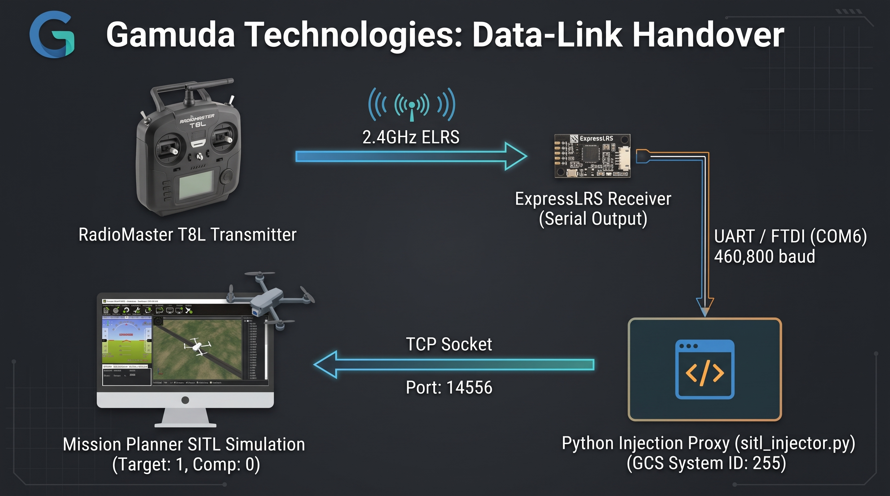

# Data-Link-Handover
a repository for handover the data link work that was done in my On-Job-Training with Gamuda Technologies.

# ExpressLRS to ArduPilot SITL Real-Time MAVLink Bridge

An ultra-low-latency hardware-in-the-loop (HIL) telemetry bridge developed during On-Job-Training with Gamuda Technologies. This repository provides the pipeline that captures native MAVLink RC override packets from an ExpressLRS (ELRS) receiver and injects them directly into ArduPilot Software-In-The-Loop (SITL) simulations via Mission Planner.

---

## 📌 Project Overview and Architecture



---

## 🛠️ Hardware & Software Stack

- **Transmitter:** Radiomaster T8L
- **Protocol:** ExpressLRS (2.4GHz) configured for MAVLink telemetry output
- **Interface:** FTDI USB-to-UART Serial Converter (`COM6`[or designated com port] `460800` baud)
- **Runtime / Libraries:** Python 3.10+, `pymavlink`
- **Ground Control & Simulation:** Mission Planner, ArduPilot SITL (Multirotor model)

---

## ⚡ Quick Start Guide

### 1. Prerequisites & Installation

Clone the repository and install dependencies:

```bash
git clone [https://github.com/masbi98/Data-Link-Handover.git]
cd Data-Link-Handover
pip install -r requirements.txt
```

### 2. Configure Mission Planner SITL

* Open Mission Planner
* Go to Simulation, choose Multirotor, and select Model. Allow the simulation to fuilly initialize.
* Open the developer utilities by pressing `Ctrl + F`, then click Mavlink.
* Configure the first row of the bridge table:
	- **Type:** `TCP`
	- **Direction:** `Inbound`
	- **Port:** `14556`
	- **Host/Baud:** mirror 14556
	- **Write:** [X] (Checked - critical for pass-through commands)
* Click Go (status much change to Started).

### 3. ArduPilot Parameter tweaks

To prevent false disarms during ground testing or packet jitters:

- Navigate to Config -> Full Parameters List.
- Set `FS_THR_Enable` to `0` (Disables RC throttle failsafe disarm during testing).
- Click Write params.

### 4. Run the Injection Script

Connect your receiver via FTDI and run (Assuming your working directory is already inside this repository):

```bash
python src/sitl_injector.py
```

### 5. Arm & Fly

* Switch to Mission Planner's Flight Data view.
* In the bottom-left **Actions** tab, set the flight mode to **Stabilize** and click **Set Mode**.
* Arm via sticks (Throttle down + Yaw right for 3s) or right-click the map -> **Arm/Disarm** -> **Force Arm**.
* Throttle up on your physical transmitter to control the virtual aircraft.

---

## 🦾 Troubleshooting Reference (System Failures Handled)

* Failed Connection/socket crashes (only one usage of socket address):
	- Causes: Background task ghosting on port `14555` or unclosed TCP relays.
	- Fixes: We routed standard connection ports exclusively onto unused port `14556`. When issues persist, kill tasks by hitting `Ctrl + C` and reboot Mission Planner to refresh system socket configurations.
* SITL parameter collection failures (No Heartbeat received):
	- Causes: Bridge logic crashing due to trying to map standard downloads inside Mission Planner.
	- Fixes: Never touch the main Mission Planer Connect button! Start SITL and connect directly using the internal bridge routing to communicate natively via GCS authentication (source_system=255).
* Uncontrolled random disarming:
	- Causes: Safety timeout failsafes and telemetry drops.
	- Fixes: Disabled internal failsafes (`FS_THR_ENABLE` to `0`) and changed raw signal tracking to asynchronous event-based pass-through triggers. No artificial delays are used, creating immediate, non-blocking control feedback.

---